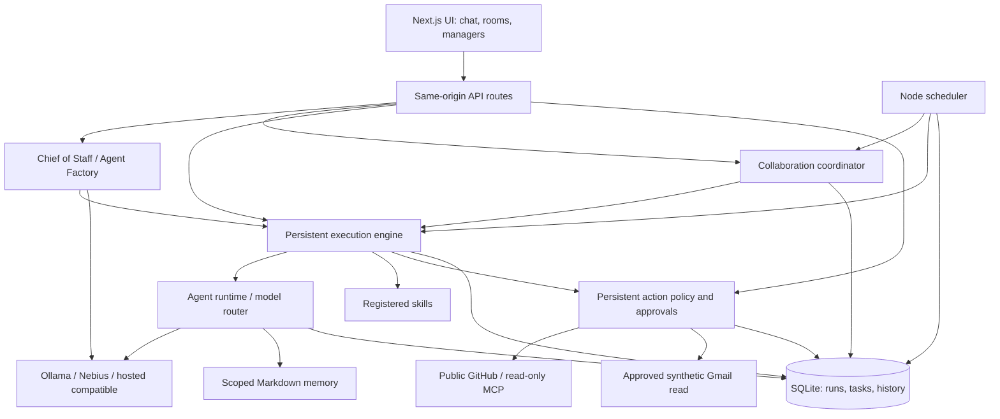

<div align="center">


# OpenCrewBot 2.0
### EDXSO AI Engineer Intern Assignment 3

A local-first AI workforce: plan, delegate, execute, review and schedule business work with persistent memory and human-controlled permissions.

[Setup](#quick-start) · [Architecture](docs/architecture.md) · [Requirements and evidence](docs/assignment-verification.md) · [Demo guide](docs/demo-guide.md) · [MIT license](LICENSE)
</div>

<!-- DEMO_START -->

## Product Demonstration

<div align="center">

### OpenCrewBot 2.0 - Autonomous AI Workforce

[](https://drive.google.com/file/d/1pb9Zw0F4gk-XodgpDLLWjhxoU3lM1YDy/view?usp=sharing)

**EDXSO AI Engineer Intern | Assignment 3**

[Watch the complete demonstration video](https://drive.google.com/file/d/1pb9Zw0F4gk-XodgpDLLWjhxoU3lM1YDy/view?usp=sharing)

</div>

The screen-recorded demonstration presents the working OpenCrewBot 2.0 application, its autonomous execution capabilities, business workflows, integrations and engineering implementation.

### Demonstration Coverage

| No. | Demonstration | Module |
| --- | --- | --- |
| 01 | Application Introduction and Dashboard | Overview |
| 02 | Dynamic Agent Factory | B |
| 03 | Chief of Staff and Intelligent Task Planning | A, D |
| 04 | Multi-Agent Collaboration and Delegation | C |
| 05 | Data Analysis and Visualization | D, F |
| 06 | MeetUniversity Competitor Intelligence | A, F |
| 07 | Aspirations Marketing Campaign | A, F |
| 08 | Human Approval and Failure Handling | D, G |
| 09 | Persistent Memory and Preference Correction | E |
| 10 | LIVE Recurring Workflow Automation | I |
| 11 | GitHub, Gmail and MCP Integrations | H |
| 12 | Multi-Model Intelligence and Token Usage | J |
| 13 | Automated Testing and Engineering Reliability | Testing |
| 14 | System Architecture, Documentation and Conclusion | Architecture |

### Implementation Highlights

- Implementation covering all ten assignment modules.
- Eight reusable executable business skills.
- Three verified integrations: GitHub, Gmail and MCP.
- Real local AI inference using Ollama and Qwen.
- Persistent task execution, dependencies and approval enforcement.
- Scheduled LIVE workflow execution.
- 122 automated tests reported passing.
- Successful production build.

### Demonstration Transparency

LIVE model outputs, deterministic skill results and simulated workflows are distinguished throughout the project documentation. Gmail and MCP demonstrations use synthetic test data. Competitor analysis uses supplied evidence. Hosted model fallback and other verification limitations are documented explicitly.

### Supporting Documentation

- [System Architecture](docs/architecture.md)
- [Assignment Verification and Test Evidence](docs/assignment-verification.md)
- [Demonstration Guide](docs/demo-guide.md)
- [Local Installation Instructions](#quick-start)

> If Google Drive is still processing the video preview, download the original MP4 to view the demonstration locally.

<!-- DEMO_END -->


## Overview

This submission extends [Studio1-OSS/OpenCrewBot](https://github.com/Studio1-OSS/OpenCrewBot), rather than replacing it. The original Next.js messaging UI, Mastra runtime, bot profiles, rooms, chat streaming and individual Markdown memories are retained. The assignment branch adds persistent task graphs, Chief of Staff planning, agent generation, bounded multi-agent collaboration, scoped memory, executable business skills, external-action approvals, integrations, recurring workflows and model routing/accounting.

**Deployment:** working local application; no public hosted instance. This is a single-owner prototype without sign-in, not a production multi-tenant service. Keep the server bound to loopback. The assignment code is on branch `assignment-3` of [the fork](https://github.com/aman07052005/OpenCrewBot/tree/assignment-3).

## Quick start

### Prerequisites

- Node.js 24 (tested development environment: Windows, Node 24.14.1).
- pnpm 11.21.0 (the version pinned by `package.json`).
- Optional: Ollama for local LIVE inference, or an owner-configured hosted provider. No API key is necessary to explore MOCK mode and deterministic skills.

```powershell
git clone --branch assignment-3 https://github.com/aman07052005/OpenCrewBot.git
cd OpenCrewBot
pnpm install --frozen-lockfile
Copy-Item .env.example .env
pnpm dev
```

Run `Copy-Item` only when `.env` does not already exist. On macOS/Linux use `cp .env.example .env` instead. Open **http://127.0.0.1:3000**. Existing local data is kept across server restarts. If extending an existing installation, back up its data directory with the server stopped before upgrading. Do not overwrite the existing `.env` or copy another user's data directory.

### Local live model (demonstrated)

Install Ollama from its official distribution, make sure it is running, and download the model used in the demonstration:

```powershell
ollama pull qwen3:4b-instruct
ollama list
```

Add these settings to your local, ignored `.env` file (replace existing definitions rather than duplicating them):

```dotenv
OPENCREWBOT_OLLAMA_ENABLED=1
OPENCREWBOT_OLLAMA_BASE_URL=http://127.0.0.1:11434/v1
OPENCREWBOT_OLLAMA_MODELS=qwen3:4b-instruct
OPENCREWBOT_PLANNER_PROVIDER=ollama
OPENCREWBOT_PLANNER_MODEL=qwen3:4b-instruct
OPENCREWBOT_AGENT_FACTORY_PROVIDER=ollama
OPENCREWBOT_AGENT_FACTORY_MODEL=qwen3:4b-instruct
OPENCREWBOT_EXECUTION_MODE=live
```

Restart the application. Open **Models & usage**, verify the Ollama connection, and edit each participating bot's model settings: Local Ollama, model `qwen3:4b-instruct`, Fixed, local-only inference enabled, 768 output tokens, no hosted fallback. Save the settings. For automatic LIVE collaboration, disable web search, code mode, browser and external connections on every participating bot. Keep Ask First for the demo. Use a small roster and short prompts; local CPU inference can be slow.

The application also supports Nebius (`NEBIUS_API_KEY`) and an explicitly allowlisted HTTPS OpenAI-compatible provider (`OPENCREWBOT_OPENAI_COMPATIBLE_*`). These hosted paths are implemented but not verified with a real hosted account for this submission. See [model setup](docs/multi-model-intelligence.md) and [routing notes](docs/module-j-acceptance.md). Optional Tavily, Browserbase, Composio and Jev credentials are described in `.env.example`; they are not required for the core local demo. Hosted services may charge for usage.

### Build and validation

```powershell
pnpm exec next typegen
pnpm exec tsc --noEmit
pnpm test
pnpm lint
pnpm build
pnpm start
```

Stop the development server before building/starting a second server. Tests use isolated storage and synthetic/fake provider inputs; they do not establish hosted-provider availability. The latest developer-run verification reported **122/122 tests passing**, TypeScript and production build passing, no lint errors and one existing `ModelsManager.tsx` hook-dependency warning. See [verification details](docs/assignment-verification.md). The final archive review did not independently rerun the dependency-backed suite.

## Assignment features

| Module | Added functionality | Interface |
| --- | --- | --- |
| A — Chief of Staff | Natural-language plan, capability discovery, executable skill/read selection, DAG validation, editable preview and final synthesis | Executions → Plan with Chief of Staff |
| B — Agent Factory | Editable live or deterministic generated profiles, unique handles, tools, enabled skills, permissions and memory initialization | New bot → Agent Factory |
| C — Collaboration | Persistent work, delegated requests, review, final and continuation stages; optional automatic local progression; pause, interrupt, revision reservation | Room → Start collaboration / history |
| D — Execution engine | SQLite-backed tasks, prerequisites, bounded concurrency, lifecycle/attempt history, approval, cancellation, timeout and recovery | Executions |
| E — Memory | Agent, room, project, preference, decision and history Markdown; revision-aware editing and provenance | Memory manager |
| F — Skills | Eight validated executable handlers with structured results and downloadable artifacts | Skills manager / execution builder |
| G — Permissions | Ask First, Controlled Access, Full Access; registered action previews, decisions, audit and invocation counts | Agent editor / Approvals |
| H — Integrations | Public GitHub REST reads, authorized synthetic Gmail read through Composio, owner-enabled read-only MCP | Connections / execution builder |
| I — Recurrence | Manual and timed runs, persisted occurrences, timezone, pause/resume, editable single-task LIVE/MOCK schedules | Schedules |
| J — Models | Per-agent routing, owner-designated categories, constrained fallback, provider verification, reported token usage and estimated cost | Models & usage / bot editor |

### Workforce and rooms

Install workforce templates in Agent Factory: **Cipher** (data), **Forge** (development), **Spark** (marketing), **Ledger** (finance), **Sentinel** (quality). Keep the original Scout, Quill and Atlas; this yields eight agents on a fresh installation. Use Agent Factory to create additional agents. The demonstrated installation also contains Nova (business intelligence) and Orion (business strategy), with Orion generated by the live local model.

Install room templates (create Nova first for Market Intelligence): Market Intelligence, Marketing Campaign, Business Analytics and Development Team. Existing Studio and custom rooms are preserved. The demonstrated Strategy Intelligence room contains Scout and Orion. Template agents and rooms are not preloaded from private demo data; recreate them using the UI.

### Eight executable skills

Market Research and Competitor Analysis organize supplied evidence; Financial Modelling computes profit/margins and projections; Presentation Creation exports a Markdown outline; Email Drafting creates text without sending; Code Review inspects supplied source text; Data Analysis handles CSV/JSON statistics and grouped charts; Lead Generation organizes supplied public organization data. The handlers are deterministic, not separate model calls. Their execution results can become inputs to dependent live agent tasks. CSV support is not native XLSX support, and a Markdown outline is not a PPTX export.

Try Data Analysis in **Skills manager** with an enabled agent and `docs/skills-sample.csv`, or use this schema-valid input:

```json
{"csv":"Region,Revenue,Units\nNorth,12000,120\nSouth,8000,80\nEast,15000,150\nWest,5000,50","groupBy":"Region","valueColumn":"Revenue"}
```

Expected: 4 rows, 3 columns, revenue 40,000, units 400, East highest at 15,000; chart-ready grouped revenue and `analysis.json`. The reported demonstration produced these values. The dataset is synthetic; the computation is real.

### Integrations and approvals

- GitHub: public metadata, directory/file inspection and supported issue/PR reads. In a LIVE execution choose `GitHub public read` and use `{"operation":"metadata","repository":"aman07052005/OpenCrewBot"}`. Assign an authorized Ask First agent. Open Approvals, inspect the exact request, approve and execute the read. A rejected request has zero invocations and dependent work skips. No repository writes.
- MCP: in a separate terminal start `node scripts/synthetic-mcp-demo.mjs`. Add `http://127.0.0.1:3021/mcp` in Connections, Test, Discover, enable a read-only tool and attach the server to the selected bot. Use `get_synthetic_product` with `{"sku":"DEMO-100"}` or `calculate_synthetic_margin` with revenue 1000 and cost 600. This is real protocol transport with deliberately synthetic business data. The execution builder also supports owner-enabled MCP reads. Trust only servers you control.
- Gmail: optional, authorized synthetic mailbox only. Follow [the dedicated Gmail setup](docs/integrations.md#gmail). The recorded demonstration read exactly the designated test message through Composio after approval; it did not send or modify mail. General mailbox automation is excluded.

Task approvals and external-action approvals are separate. The persistent registry supports GitHub/MCP reads, dedicated synthetic Gmail reads, and simulated email sending. Full Access does not authorize arbitrary writes. Legacy chat/provider approvals and direct owner integration checks are separate from this registry; the app does not claim universal persistent auditing of every legacy tool path.

## Architecture



See [architecture and design decisions](docs/architecture.md) for source locations, persistence and boundaries. Detailed module notes are linked in [the requirements matrix](docs/assignment-verification.md). Some module notes describe their initial development stage; this README, architecture and verification matrix describe the final reviewed snapshot and take precedence where earlier notes differ.

## Data, security and costs

App state lives in `data/opencrewbot.db`, Mastra thread state in `data/mastra.db`, and memories in `data/workspaces/` and `data/memory/`. `OPENCREWBOT_DATA_DIR` can relocate them. `.env` and `data/` are ignored by Git. Keep credentials server-side and do not commit real execution histories, connection identifiers or private mailbox data. Configured MCP credentials can reside in local settings; provider model keys are environment-based. Redaction and read-only annotations are not substitutes for trusted inputs, providers and servers.

Local-only inference limits the agent's own model routing, not complete information isolation across every chat, room or tool. Use synthetic/non-confidential inputs in cross-agent work. No authentication or production distributed workers are included. Do not expose the localhost server to the internet. The scheduler needs a running server. Usage is provider-reported where available, unknown otherwise; hosted prices are estimates and local compute is not free of electricity/hardware costs. No enforceable monetary reservation is implemented.

## Known limitations

- Live planning is model-dependent: invalid schemas/permissions are rejected, and local planning can time out or create redundant tasks requiring owner edits. The final planner can select supported registered skills and read operations, but cannot create arbitrary tools or grant approvals.
- Automatic LIVE room collaboration is constrained to local-only Ollama participants with external tools disabled; manual room operation is separate. Live room completion and MOCK revision continuation were demonstrated separately, not a single fully live interrupted-and-revised workflow.
- Execution uses an approximate 4,096-token context budget and bounded prerequisite projections; full outputs remain in history, but projections can omit relevant details. Split larger work when needed.
- Public GitHub metadata was retrieved and analyzed in a completed live run. Proposed inspection steps are not proof of an actual issue-by-issue code audit. Real writes and replay of interrupted external actions are intentionally unavailable.
- Scheduled external actions are disallowed; recurring competitor reports use supplied evidence rather than refreshing external market sources. Browser verification of the newly enabled LIVE schedule is tracked separately from the earlier MOCK recurrence.
- Hosted provider inference/fallback, live interruption during an active call, and several end-to-end combinations remain unverified. See the [verification matrix](docs/assignment-verification.md) for exact evidence and gaps.

## Attribution and license

Original OpenCrewBot by Studio1HQ, MIT licensed (copyright 2026 Studio1HQ). See [LICENSE](LICENSE) and the [upstream repository](https://github.com/Studio1-OSS/OpenCrewBot). This assignment retains the upstream runtime and interface and adds the modules listed above. Runtime dependencies include Next.js/React, Mastra, libSQL, Zod, Tailwind, AI SDK's OpenAI-compatible adapter, Composio and Tavily; their licenses and service terms remain applicable. Exact dependency versions are in `package.json` and `pnpm-lock.yaml`. No provider account, model weights, private runtime state or credentials are distributed in this repository.