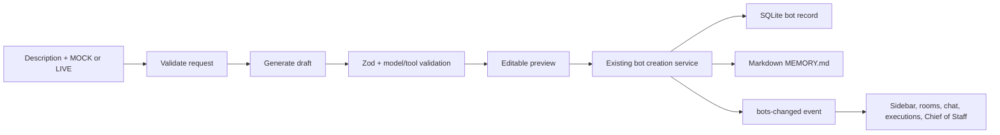

# Agent Factory

The Agent Factory creates configurable OpenCrewBot agents from a natural-language description. It uses the existing bot record, model catalog, tools, memory files, permissions, and `bots-changed` event. The existing manual bot form remains available from the **New bot** drawer.

## Architecture

The browser sends a description and an explicit generation mode to the Agent Factory API. The server validates the request, reads the currently available model IDs and configured agents, then produces a strictly validated editable draft. Saving a draft calls the same bot creation service as manual setup. That service assigns the internal ID and unique mention handle, writes the JSON bot record to SQLite, initializes `data/workspaces/<bot-id>/MEMORY.md`, and publishes `bots-changed`.

The app already refreshes its bot list when that event arrives. The new record is therefore available to the sidebar, direct conversations, room member selection, executions, and Chief of Staff capability discovery without restarting the server. Older bot JSON remains valid because Agent Factory metadata is optional.

No database schema migration is needed. Additional factory metadata is stored additively inside the existing bot JSON record in the `bots` table.

## Generation flow

1. In **New bot**, choose **Agent Factory** and describe the job, audience, responsibilities, boundaries, and preferred answer format.
2. Select **MOCK · DETERMINISTIC** or **LIVE MODEL**. The selected mode is shown in the generated preview.
3. Review and edit the proposed identity, role, handle, instructions, model, supported tools, permission level, expected output format, and reusable skill identifiers.
4. Save the draft. The server validates it again before persistence.

The generated draft does not include an internal ID, credentials, connected services, arbitrary tool definitions, or executable skills. The server selects the ID and a unique handle when saving. New generated and template agents use **Ask First** by default.

## Configuration schema

A saved bot retains the original OpenCrewBot fields:

- `name`, `handle`, `title`, `description`, `instructions`, `emoji`, and `color`
- `model`, `tools`, `connections`, `approval`, and `pinned`

Factory-created records can also contain optional `agentConfig` metadata:

- `source` and `generationMode` identify a factory-created agent or a workforce template.
- `templateId` identifies one of the five built-in workforce templates when applicable.
- `creationRequest` stores the natural-language brief.
- `skillIds` stores reusable skill identifiers as descriptive metadata.
- `memory` records whether the existing Markdown memory tool is enabled.
- `expectedOutputFormat` describes the intended shape of the agent’s response.

The model catalog and tool schema are allowlists. Only model IDs returned by the existing model service and the existing boolean tool settings are accepted. The Agent Factory does not create connected-service permissions. Skill IDs are metadata only; choosing one does not install code or add a capability.

## API endpoints

- `POST /api/agent-factory/generate` takes `{ "description": "...", "generationMode": "mock" | "live" }` and returns `{ "draft": ... }`.
- `POST /api/agent-factory/create` takes `{ "draft": ... }`, validates it, and returns `{ "bot": ... }`.
- `POST /api/agent-factory/templates/install` installs any missing built-in workforce templates and returns installed, already-installed, and conflicting names.

The APIs use the same local request handling and validation conventions as existing bot routes.

## MOCK and LIVE modes

**MOCK** creates a repeatable, role-aware configuration locally. It makes no LLM request and is useful for development without a model key. The result is labelled as deterministic in both the UI and stored metadata.

**LIVE** uses Mastra’s existing `Agent` runtime with the configured Nebius provider and a structured Zod output schema. The default configuration model is `DEFAULT_MODEL`. `OPENCREWBOT_AGENT_FACTORY_MODEL` can select another model for configuration generation. A valid `NEBIUS_API_KEY` is required. Live generation fails with an explicit error if the key is missing, the model fails, or the output is malformed; the service never silently changes a live request into a mock result.

Live generation can incur model charges. Automated tests inject fake model outputs and do not make paid calls.

## Workforce templates

Choose **Customize** to load a template into the editable preview, or use **Install workforce templates** to add all missing templates:

| Agent | Role | Main use |
| --- | --- | --- |
| Cipher | Data Analyst | Spreadsheet analysis, interpretation, calculations, and visualization recommendations |
| Forge | Software Developer | Repository analysis, code review, technical planning, and software engineering |
| Spark | Marketing Strategist | Audience research, campaign strategy, content planning, and marketing analysis |
| Ledger | Financial Analyst | Revenue analysis, financial modelling, forecasting, and business performance |
| Sentinel | Quality Assurance | Fact verification, output review, error identification, and quality assessment |

Template installation is idempotent. Installed template IDs are stored with their bot records, so repeated installation skips them. An existing agent with a colliding name or handle is reported as a conflict and is not changed. Existing memory files are never overwritten. Together with Scout, Atlas, and Quill, installing all five gives the user eight agents to configure.

## Security and permissions

Generated model output is parsed with strict Zod schemas. The generator cannot provide an approval mode, ID, handle, connections, credentials, or arbitrary tools. The application assigns `approval: "ask"` regardless of model output. A user can edit a generated draft to select the existing **Full access** option explicitly; that is the same permission control offered by manual bot setup.

The supported tool list is limited to the application’s existing Web search, Memory, Code mode, Browser, and Ask user settings. Enabling a setting does not bypass existing approval prompts or integration-key requirements. New agents receive no connected-service IDs by default. Sensitive strings are redacted before generated configuration text is returned or saved.

## Manual verification

1. Start the app with `pnpm dev` and open it on the configured localhost address.
2. Open **New bot**, select **Agent Factory**, enter a role description, and keep **MOCK** selected. Generate a draft, change the name or instructions, and save it.
3. Confirm the agent appears in the sidebar and can be opened. Check that its new `data/workspaces/<id>/MEMORY.md` file contains the initial heading.
4. Open room creation and an execution plan to confirm the new agent is selectable. In Chief of Staff, generate a plan and confirm the new role can appear in the capability list.
5. Click **Install workforce templates** twice. The first run adds the missing templates; the second reports them as already installed. Confirm Scout and any pre-existing memories remain unchanged.
6. To verify LIVE mode, configure a valid `NEBIUS_API_KEY`, select **LIVE MODEL**, and generate a draft. This sends a real request and may incur charges. To verify failure behavior, use a test-only injected generator that rejects and confirm the API shows an error rather than a MOCK draft.
7. Select **Manual setup** in the New bot drawer and confirm the original form still creates a bot.

## Current limitations

- The deterministic mock generator uses simple role and keyword rules; it is meant for local development, not nuanced planning.
- Live configuration quality depends on the chosen model and service availability. Strict validation can reject otherwise plausible but out-of-schema output.
- Skill identifiers are descriptive metadata for future modules and do not load skills today.
- Template descriptions do not add spreadsheet, chart rendering, repository editing, or independent verification integrations. Agents can only use enabled tools already implemented in OpenCrewBot.
- Model selection is limited to the existing model catalog. Agent Factory does not define new providers or model credentials.
- The UI supports the current Ask First and Full access settings only; it does not introduce additional permission levels.
