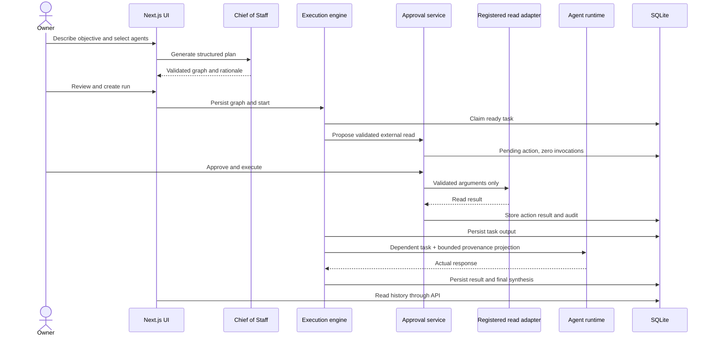

# Architecture and implementation map

OpenCrewBot 2.0 is an incremental extension of the original single-owner Next.js application. UI components call local API routes; services validate inputs and persist durable state, then invoke the existing Mastra-based runtime or explicitly registered deterministic operations. Ordinary chat and room routing remain separate from persistent execution runs. The repository does not depend on a second orchestration service.

## Component map

| Area | UI / API | Server implementation |
| --- | --- | --- |
| Original chat | `ChatView.tsx`, `OpenCrewBotApp.tsx`, `/api/conversations` | `runtime.ts`, `service.ts`, `rooms.ts`, `jev.ts`, `tools.ts` |
| Planning | `ExecutionDashboard.tsx`, `/api/chief-of-staff` | `chief-of-staff.ts`, `chief-of-staff-model.ts`, `local-planner-prompt.ts` |
| Factory | `AgentFactoryForm.tsx`, `/api/agent-factory` | `agent-factory.ts`, `agent-factory-service.ts`, `agent-factory-model.ts`, `bot-creation.ts` |
| Rooms | `CollaborationPanel.tsx`, `/api/rooms/[id]/collaborations` | `collaboration-service.ts`, `collaboration-store.ts`, `collaboration-protocol.ts`, `collaboration-schema.ts` |
| Execution | `ExecutionDashboard.tsx`, `/api/execution-runs` | `execution-engine.ts`, `execution-service.ts`, `execution-adapter.ts`, `execution-task-executor.ts`, `execution-schema.ts` |
| Memory | `MemoryManager.tsx`, `/api/memory` | `scoped-memory-service.ts`, `memory-store.ts`, `memory-files.ts` |
| Skills | `SkillsManager.tsx`, `/api/skills` (catalog) | `skills.ts`, shared `agent-skills.ts`, execution adapter |
| Policy | `ApprovalsManager.tsx`, `/api/actions` | `approval-service.ts`, `approval-schema.ts`, `execution-actions.ts`, `execution-permissions.ts` |
| Integrations | `ConnectionsPanel.tsx`, `/api/integrations` | `github-integration.ts`, `gmail-integration.ts`, `gmail-service.ts`, `mcp-servers.ts`, `integration-safety.ts` |
| Scheduler | `ScheduledWorkflowsManager.tsx`, `/api/scheduled-workflows` | `scheduler.ts`, `scheduled-workflows.ts`, `scheduled-workflow-plan.ts`, `workflow-schedule.ts`, `scheduler-schema.ts` |
| Models | `ModelsManager.tsx`, `BotForms.tsx`, `/api/models` | `model-routing.ts`, `provider-runtime.ts`, `ollama-structured.ts`, `model-usage.ts`, `model-schema.ts` |

UI paths are under `src/components/`; server paths are under `src/lib/server/`; API routes are under `src/app/api/`. Shared contracts are under `src/lib/shared/`.

## Execution data flow

The owner explicitly approves the preview before execution. The planner is tool-free and cannot grant permissions. Skill tasks call deterministic handlers; they do not need a model or network. Ordinary agent tasks use the model route and a fresh isolated task session. The external adapter gets only its validated arguments, not private memory or arbitrary instruction text. The final task depends on every work task. If a prerequisite fails, downstream work is skipped instead of inventing success. The complete tool result remains in persistent history even when model context receives a compact projection.

## Persistence

`db.ts` applies additive schema migrations. The primary store is `data/opencrewbot.db` (libSQL SQLite); the Mastra runtime has `data/mastra.db` for model-facing threads. Original bots, rooms, settings, messages and conversations remain intact. New principal tables:

| Tables | Purpose |
| --- | --- |
| `execution_runs`, `execution_tasks`, `execution_task_dependencies` | DAG, lifecycle, timeouts, attempts, inputs, outputs, errors |
| `collaboration_sessions`, `collaboration_rounds`, `collaboration_automation` | Session, ordered linked runs and opt-in progression |
| `collaboration_revision_locks`, `collaboration_revision_submissions` | Server-side revision reservation and transactional continuation deduplication |
| `action_requests`, `action_audit_log` | Authorization, decisions, audit, invocation count; unique action per execution task |
| `scheduled_workflows`, `scheduled_workflow_occurrences` | Schedule definitions and durable occurrence history; one open occurrence per schedule |
| `model_usage_records` | Selected provider/model, reason, attempts, tokens, estimates and errors |

Markdown scopes are stored independently under the configured data directory: `workspaces/<botId>/MEMORY.md`, `memory/room/<roomId>/MEMORY.md`, `memory/project/<projectId>/MEMORY.md`, `memory/preferences/owner/MEMORY.md`, `memory/decisions/owner/MEMORY.md`, `memory/history/owner/MEMORY.md`. The catalog stores explicit room/project links; adjacent audit JSONL files record the revision, date, actor and reason. A stale revision is rejected. Audit is operational history, not a tamper-proof log.

## Design decisions and trade-offs

**Bounded orchestration.** Validate task IDs, acyclic dependencies, roles, skill contracts and permitted operations before persistence. Chief of Staff plans are limited to 20 tasks; collaboration is bounded to eight stages, 40 created tasks and six delegated tasks. The scheduler may progress a room without a browser tab after explicit opt-in; automatic LIVE rooms require local-only Ollama and disabled external tools. Pause prevents new stages; interrupt cancels current work on a best-effort basis. A revision reservation disables automatic progression on the server, and a consumed lease cannot create duplicate continuations. Only unstarted work can be safely resumed; prior attempts are not replayed automatically.

**Failure and recovery.** SQLite conditional claims/unique constraints protect durable transitions. The Node scheduler is process-local, registered in `src/instrumentation.ts`, disabled for tests/builds, and coalesces missed occurrences. Restart reconciliation handles stranded claims and expired linked approvals. Rejection or expiry leaves zero provider invocations for an unexecuted request and prevents dependent work. Cancellation of an already issued model/network request cannot guarantee a provider never received it. No automatic replay of ambiguous external effects.

**Context management.** The live task executor projects large results with task/agent/operation provenance, marks them as untrusted and preserves original outputs. Its approximate budget is 4,096 tokens using three characters per estimated token, with a default output reservation of 768 and an upper bound of 1,536 for isolated tasks. This is not an exact tokenizer; oversized input is rejected or projected, not silently treated as complete evidence.

**Model separation.** Ollama structured planning/factory generation uses a native local JSON-schema path; compatible inference uses the pinned AI SDK adapter through Mastra. Fixed routing selects the primary; automatic routing uses owner-designated task categories, then ordered allowed alternatives for narrowly defined transient failures. Never fall back from LIVE to MOCK. Local-only routing excludes hosted models; shared workflows are not a full data-isolation boundary. Model ledger fields remain unknown when not reported.

**Permission separation.** Task approval authorizes scheduling, not an external call. A registered external read goes through policy, durable proposal and atomic action claim; Controlled Access applies scoped allowlists and limits; Full Access still validates. Gmail is always explicitly approved and restricted to a synthetic test message. Direct integration UI checks are owner-triggered; original provider-managed chat approval paths are not the same persistent audit. No general external write adapter exists; simulated email is explicitly non-delivering.

**Local boundary.** `pnpm dev` and `pnpm start` bind to 127.0.0.1. `src/proxy.ts` rejects unapproved host/cross-origin browser API requests. There is no login or tenant isolation. Keep the app local. Secrets stay in ignored environment/settings data; outputs are redacted where supported, not guaranteed free of sensitive strings.
